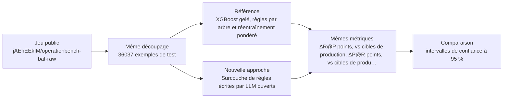
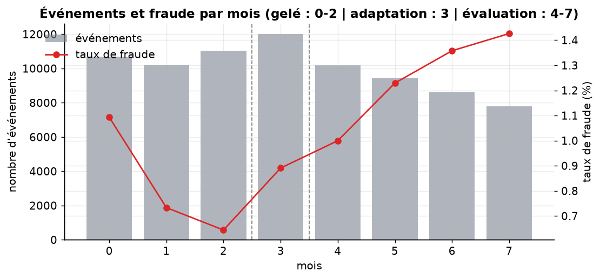
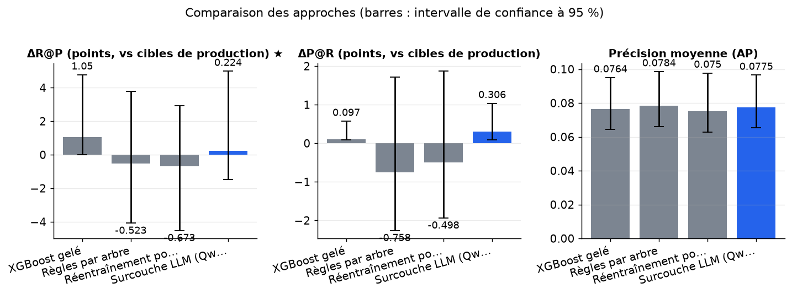
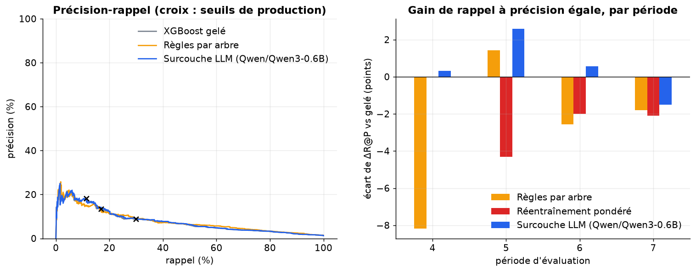
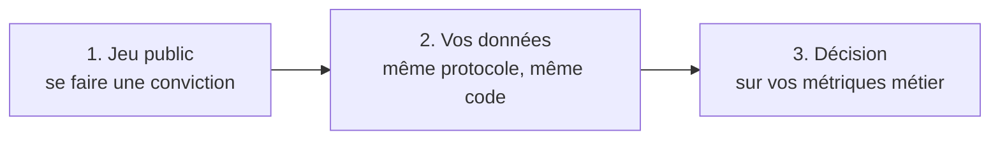

# Une surcouche de règles écrites par LLM améliore-t-elle un détecteur de fraude gelé mieux qu'une extraction de règles classique ou un réentraînement pondéré ?

> **En bref.** Aucune conclusion possible : la surcouche n'a quasiment pas agi avec un petit LLM, et tous les écarts sont dans le bruit. Le dispositif de comparaison est correct, mais seul le passage à l'échelle complète pourrait trancher. ΔR@P (points, vs cibles de production) : 0,224 [-1,49 ; 4,98] pour Surcouche LLM (Qwen/Qwen3-0.6B), contre -0,673 [-4,52 ; 2,93] pour Réentraînement pondéré (36037 exemples de test, échelle réduite, chiffres indicatifs).

## Sommaire

1. [La question](#la-question)
2. [Le protocole](#le-protocole)
3. [Les résultats](#les-résultats)
4. [Ce qu'il faut retenir](#ce-quil-faut-retenir)
5. [Rejouer l'expérience](#rejouer-lexpérience)
6. [Contenu du dépôt](#contenu-du-dépôt)
7. [Références](#références)
8. [Glossaire](#glossaire)

## La question

Un détecteur de fraude déjà déployé (« gelé ») laisse passer certaines fraudes. On se demande si de petites règles écrites par des modèles de langage, ajoutées à son score sans le modifier, l'améliorent mieux que des règles extraites par un simple arbre de décision, ou qu'un réentraînement ciblé. Chaque règle n'est gardée que si elle a prouvé son utilité sur un mois récent, et on peut la retirer à tout moment pour revenir au score d'origine. On compare, aux mêmes seuils d'alerte et sur les mois suivants, le rappel obtenu à précision égale. Si les règles du LLM ne font pas mieux que celles de l'arbre, leur coût de génération et de revue n'est pas justifié.

**Hypothèse testée.** Sur les mois ultérieurs à l'entraînement d'un XGBoost gelé, la surcouche de règles LLM filtrées par lift ne dégrade pas le rappel à précision égale (ΔR@P ≥ 0, IC95 % excluant −0,5 point) et ne bat pas de plus de 0,3 point une extraction de règles par arbre de décision sur la même fenêtre d'adaptation.

| | Référence | Nouvelle approche |
|---|---|---|
| **Approche** | XGBoost gelé, règles par arbre et réentraînement pondéré | Surcouche de règles écrites par LLM ouverts |
| **Principe** | Détecteur XGBoost entraîné sur les premiers mois puis gelé ; correctifs de référence : règles extraites par arbre peu profond sur la fenêtre d'adaptation, et poursuite d'entraînement pondérée. | Les valeurs SHAP du modèle gelé repèrent les variables sous-pondérées ; plusieurs LLM proposent chacun 10 jeux de règles (conjonctions de seuils) ; un filtre par lift garde les règles utiles ; chaque règle ajoute log(lift) au logit ; le score est remappé sur l'échelle d'origine. |
| **Mise en œuvre** | xgboost XGBClassifier (scale_pos_weight, 300 arbres, profondeur 6) entraîné sur les mois 0-2 ; baseline règles : DecisionTreeClassifier de profondeur 3 sur le mois 3, mêmes filtres (lift > 1, ≥ 3 déclenchements) et même ajout de log-lift au logit ; baseline réentraînement : 50 arbres supplémentaires pondérés sur les fraudes manquées (xgb_model=) ; mêmes seuils d'alerte pour toutes les méthodes. | SHAP via xgboost pred_contribs=True ; prompt avec noms de variables, quantiles et écarts SHAP ; génération par transformers (température 0,7, 10 tirages par modèle, JSON strict, validation par parse et noms de colonnes valides) ; règle retenue si lift > 1 et ≥ 3 déclenchements sur la fenêtre d'adaptation ; log-lift ajouté par tranche de seuil ; moyenne des tirages ; modèle de base inchangé. En phase privée, génération via le LLMaaS. |
| **Modèles** | — | [`Qwen/Qwen2.5-3B-Instruct`](https://huggingface.co/Qwen/Qwen2.5-3B-Instruct), [`HuggingFaceTB/SmolLM3-3B`](https://huggingface.co/HuggingFaceTB/SmolLM3-3B), [`Qwen/Qwen3-1.7B`](https://huggingface.co/Qwen/Qwen3-1.7B) |

## Le protocole



- **Données** : [`jAEhEEkIM/operationbench-baf-raw`](https://huggingface.co/datasets/jAEhEEkIM/operationbench-baf-raw) (configuration `default`), évaluation sur le découpage `train` (36037 exemples). Jeu public d'ouverture de comptes très déséquilibré (~1 % de fraude), avec axe temporel et variables nommées : permet un test de non-dégradation et la comparaison aux références.
- **Écarts avec des données réelles** : Synthétique et anonymisé, sans biais de sélection ni cohorte non biaisée ; gains attendus minimes ; licence cc-by-nc-sa-4.0 (évaluation seulement) ; le split unique peut concaténer Base et variantes (à contrôler au chargement, lecture en streaming des premières lignes) ; pas de données françaises.
- **Déroulé** : On lit en flux le premier million de lignes du split train de BAF, on contrôle le taux de fraude (~1 %) et la présence des mois 0 à 7. Un XGBoost pondéré est appris sur les mois 0-2 puis gelé ; le mois 3 sert à l'adaptation (seuils d'alerte à 1/2/5 %, SHAP, règles par arbre de profondeur 3, règles LLM, réentraînement pondéré de quelques arbres) ; les mois 4-7 servent à l'évaluation. Toutes les règles passent le même filtre (lift > 1, ≥ 3 déclenchements) et ajoutent un log-lift par tranche de score, suivi d'un remappage par quantiles. ΔR@P et ΔP@R sont mesurés aux cibles des trois points de production du modèle gelé, avec un IC 95 % par bootstrap par blocs contigus, apparié entre méthodes. Le verdict porte sur les écarts appariés surcouche − gelé et surcouche − arbre ; on rapporte aussi l'AP, les taux de règles gardées et invalides et la corrélation de rang.
- **Deux échelles, un seul code** : l'échelle réduite (36037 exemples, CPU, 2 min) valide la mécanique ; l'échelle complète n'a pas été exécutée (lancement sur Colab impossible) : résultats indicatifs.



*Nombre d'événements (barres) et taux de fraude en % (courbe) par mois ; les pointillés séparent la fenêtre du modèle gelé, l'adaptation et l'évaluation.*

**Les métriques**

| Métrique | Ce qu'elle mesure | Meilleur si |
|---|---|---|
| ΔR@P (points, vs cibles de production) ★ | Meilleur rappel atteint sans descendre sous la précision du modèle gelé à ses seuils de production, moins le rappel du gelé à ces seuils, moyenné sur trois seuils ; l'écart d'un correctif à la valeur du gelé est son gain propre. | plus haut |
| ΔP@R (points, vs cibles de production) | Meilleure précision atteinte sans descendre sous le rappel du modèle gelé à ses seuils de production, moins la précision du gelé à ces seuils. | plus haut |
| Précision moyenne (AP) | Aire sous la courbe précision-rappel sur la fenêtre d'évaluation ; le hasard vaut le taux de fraude. | plus haut |
| Part des règles gardées | Part des règles valides qui passent le filtre (lift > 1, au moins 3 déclenchements) sur la fenêtre d'adaptation. | — |
| Part des règles invalides | Part des règles proposées par le LLM illisibles ou citant une variable inconnue, tirages illisibles compris. | plus bas |
| Corrélation de rang avec le gelé | Corrélation de Spearman entre le score corrigé et celui du modèle gelé : proche de 1, le classement change peu. | — |

★ métrique principale : c'est elle qui tranche la question.

## Les résultats

| Approche | ΔR@P (points, vs cibles de production) ★ ↑ | ΔP@R (points, vs cibles de production) ↑ | Précision moyenne (AP) ↑ | Part des règles gardées | Part des règles invalides ↓ | Corrélation de rang avec le gelé | Latence médiane (ms) ↓ |
|---|---|---|---|---|---|---|---|
| XGBoost gelé (référence) | **1,05 [0 ; 4,76]** | 0,097 [0,0864 ; 0,571] | 0,0764 [0,0645 ; 0,095] | — | — | — | 1,85 |
| Règles par arbre (référence) | -0,523 [-4,09 ; 3,8] | -0,758 [-2,26 ; 1,72] | **0,0784 [0,066 ; 0,0986]** | 0,5 | — | 0,958 | 2 |
| Réentraînement pondéré (référence) | -0,673 [-4,52 ; 2,93] | -0,498 [-1,94 ; 1,87] | 0,075 [0,0627 ; 0,0977] | — | — | 0,932 | 1,83 |
| Surcouche LLM (Qwen/Qwen3-0.6B) (nouvelle approche) | 0,224 [-1,49 ; 4,98] | **0,306 [0,0903 ; 1,03]** | 0,0775 [0,0655 ; 0,0965] | 0,25 | 0,8 | 0,999 | 1,93 |

★ métrique principale · ↑ plus haut = meilleur · ↓ plus bas = meilleur · entre crochets : intervalle de confiance à 95 % (bootstrap) · en gras : la meilleure valeur.



*Rappel à précision égale et précision à rappel égal (points, par rapport aux cibles de production du modèle gelé), et AP de chaque approche, avec IC à 95 % ; la barre du gelé est le niveau de départ.*



*À gauche, courbes précision-rappel sur la fenêtre d'évaluation (croix : points de fonctionnement du modèle gelé). À droite, écart de ΔR@P au modèle gelé en points, par période et par correctif ; une barre au-dessus de 0 est un gain.*

**Lecture** (confiance faible). À l'échelle réduite (80 000 lignes, XGBoost à 50 arbres, un seul LLM de 0,6 Md avec 3 tirages), la surcouche LLM change à peine le score : une seule règle est gardée sur quatre valides. Son ΔR@P apparié au gelé est de −0,82 point, IC 95 % [−2,09 ; +1,80]. La non-dégradation n'est donc pas établie et aucun gain n'est démontré. L'écart avec l'arbre (+0,75 point, IC [−0,92 ; +5,23]) est non concluant, et l'arbre et le réentraînement sont eux aussi non distinguables du gelé. Le code de calcul, la réversibilité et la comparaison appariée semblent corrects, mais les chiffres ne permettent pas de trancher. Ils ne peuvent pas non plus être comparés au +2,26 de la source, obtenue sur un autre jeu et avec trois LLM.

## Ce qu'il faut retenir

**Réserves**

- Le petit LLM n'a fourni qu'une règle exploitable. L'écart avec le modèle gelé reflète donc cette règle et le bruit, pas la méthode décrite dans la source.
- Les gains sont mesurés avec un seuil réajusté après coup sur les données d'évaluation. Ils sont donc un peu plus favorables que ce qu'on obtiendrait en production avec le seuil fixé d'avance.

**Limites**

- Le jeu BAF est synthétique, sans vrai biais de sélection en amont : on n'y attend au mieux qu'une absence de dégradation.
- Le ΔR@P et le ΔP@R contiennent un bonus de re-choix du seuil a posteriori, commun à toutes les approches. Seuls les écarts appariés au modèle gelé mesurent le gain propre d'un correctif.
- À l'échelle réduite, un LLM de 0,6 Md avec 3 tirages juge le dispositif, pas la qualité de l'ensemble de trois modèles de la source.
- Une seule fenêtre d'adaptation (un mois) : les règles peuvent coller à ce mois et s'user ensuite.
- La lisibilité des règles et leur revue par un expert ne sont pas mesurées.

**Pistes d'amélioration**

- Les ΔR@P bruts incluent un bonus de seuil commun à toutes les approches. Il faut lire l'écart au modèle gelé, dont l'IC contient 0 pour tous les correctifs.
- Avec si peu de fraudes, aucun classement entre arbre, réentraînement et surcouche n'est fiable. Ces chiffres ne permettent pas de trancher.
- Sur données internes, le détecteur évalué serait un modèle de substitution. Les gains ne seraient pas forcément ceux obtenus sur le détecteur réellement en production.

## Rejouer l'expérience



### Sur le jeu public

```bash
pip install -r requirements.txt
jupyter lab experiment.ipynb
```

Dans la cellule de paramètres : `PHASE = "public"`, puis `SCALE = "reduced"` (quelques minutes sur CPU, pour vérifier) ou `SCALE = "full"` (résultats publiés). Les résultats sont écrits dans `outputs/results_public.json`, les figures dans `outputs/figures/` (les résultats publiés en sont une copie, dans `results/` et `figures/`).

### Sur vos données (environnement de services financiers)

Le même protocole, sur vos données, dans votre environnement : seule la cellule `PRIVATE_CONFIG` s'adapte. Le code de cette phase a été exécuté de bout en bout sur un jeu factice écrit comme un vrai export (dossier de fichiers, CSV « ; » en Windows-1252, colonnes à faire correspondre), contre un service simulé à la convention OpenAI (clé lue dans un fichier de secret), modèles chargés hors ligne.

**1. Préparer le jeu de données.** Colonnes attendues (les noms peuvent différer : on les fait correspondre dans `PRIVATE_CONFIG["columns"]`) :

| Colonne attendue | Type | Contenu |
|---|---|---|
| `is_fraud` | int | Étiquette de fraude confirmée (0/1) |
| `event_time` | datetime | Date de l'événement pour le découpage temporel |
| `features` | colonnes numériques et catégorielles nommées | Variables du détecteur en production, avec noms explicites |
| `frozen_score` | float | Score du détecteur en production au moment de la décision |
| `was_filtered_upstream` | bool | Événement bloqué par un filtre amont (mesure du biais de sélection) |

Volume conseillé : ≥ 1 M d'événements sur ≥ 6 mois, ≥ 2 000 fraudes confirmées sur la fenêtre d'évaluation.

**Conditions pour que la comparaison soit concluante**

- Fenêtres séparées chronologiquement (modèle gelé, adaptation, évaluation), jamais mélangées
- Étiquettes de fraude matures (délai de confirmation écoulé) sur toutes les fenêtres
- Au moins 2 000 fraudes sur la fenêtre d'évaluation et 500 sur celle d'adaptation
- Variables nommées explicitement et décrites ; exclure celles postérieures à la décision
- Conserver ou construire une cohorte non filtrée en amont pour évaluer le biais de sélection
- Même seuil d'alerte de production pour toutes les méthodes
- Anonymisation, exclusion des données personnelles directes ; contrôle d'équité sur les variables sensibles

**Constituer l'extraction.** Extraire les événements (transactions ou ouvertures de compte) avec les variables du détecteur, le score de production et la décision, joindre les étiquettes de fraude confirmées, filtrer doublons et événements de test, découper par fenêtres temporelles, échantillonner si besoin les non-fraudes en conservant leur poids.

**2. Rendre les modèles disponibles hors ligne** (si l'environnement n'a pas accès à Internet) :

```bash
python download_models.py ./models --scale full   # sur un poste connecté
```

puis copier le dossier dans l'environnement et le désigner par `LOCAL_MODELS_DIR`. Les révisions téléchargées sont celles des résultats publiés.

**3. Configurer** l'environnement du notebook à partir de `private.env.example` (ou directement la cellule `PRIVATE_CONFIG`). Jamais de clé dans le notebook : une variable, un fichier de secret monté ou la saisie masquée.

| Variable | Rôle |
|---|---|
| `PRIVATE_DATA` | jeu de données : fichier ou dossier (csv, tsv, parquet, jsonl, json, xlsx) ; `fake` pour tester le code sur un jeu factice |
| `LOCAL_MODELS_DIR` | (facultatif) dossier des poids copiés localement (`org--nom/`), pour travailler sans Internet |
| `LLMAAS_BASE_URL, LLMAAS_MODEL` | service LLM interne à la convention OpenAI (URL en `/v1`, nom du modèle) |
| `LLMAAS_API_KEY ou LLMAAS_API_KEY_FILE` | clé du service, par variable ou par fichier de secret monté |
| `<SERVICE>_HEADERS` | (facultatif) en-têtes HTTP exigés par la passerelle, objet JSON |
| `HTTPS_PROXY, SSL_CERT_FILE, PIP_INDEX_URL` | (facultatif) proxy, autorité de certification et miroir PyPI d'entreprise |
| `SERVICE_TIMEOUT_S, SERVICE_MAX_RETRIES` | (facultatif) délai (120 s) et tentatives (3) par appel de service |

**4. Lancer** avec `PHASE = "private"` (et `SCALE = "full"`). La cellule d'initialisation affiche une liste de contrôle (jeu, colonnes, modèles, services) et s'arrête sur ce qui manque, avant tout calcul. Les résultats sont écrits dans `outputs/results_private.json` (avec versions, machine, graine et empreinte des données).

**5. Interpréter.** Métriques métier à suivre : Rappel à précision de production, précision à rappel donné, volume d'alertes supplémentaires, montant fraudé évité, nombre de règles et lisibilité.

**Garde-fous.** Le LLM ne décide rien en ligne ; règles revues par un expert métier avant usage ; coupure instantanée de la surcouche ; suivi de l'équité sur les groupes protégés ; données traitées uniquement par un service LLM interne. En phase `private`, le notebook refuse les services publics (OpenAI, Anthropic, Mistral, Hugging Face…) et le HTTP non chiffré, n'affiche aucune donnée brute et coupe la télémétrie des bibliothèques ; avec `LOCAL_MODELS_DIR`, il travaille sans accès à Internet.

## Contenu du dépôt

| Fichier | Contenu |
|---|---|
| `experiment.ipynb` | le notebook : question, données, deux approches, évaluation, analyse, bilan (sorties incluses) |
| `helpers.py` | fonctions communes : phases et échelles, services internes, lecture des données, mesures, figures |
| `results/results.json` | résultats publiés (échelle réduite) : métriques, intervalles, latences, versions et machine |
| `figures/` | figures du notebook reprises dans ce README |
| `requirements.txt` | versions exactes des bibliothèques utilisées |
| `private.env.example` | variables d'environnement pour exécuter le notebook sur vos données |
| `download_models.py` | téléchargement des poids des modèles, pour un environnement sans Internet |

## Références

**Sources de l'approche**

- [Patching the Blind Spots: Reversible LLM Rule Overlay for Frozen Fraud Detectors](https://arxiv.org/abs/2611.08714)

**Autres jeux de données examinés**

| Jeu | Accès | Intérêt | Pourquoi pas ici |
|---|---|---|---|
| [AMLGentex/sweden_100K_easy](https://huggingface.co/datasets/AMLGentex/sweden_100K_easy) | Hugging Face, libre | Journal AML synthétique avec variantes de décalage. | Signal dans le graphe, agrégations par compte nécessaires, hors cadre de la méthode. |
| [Kshitijbhatt1998/ieee-fraud-detection-pipeline-features](https://huggingface.co/datasets/Kshitijbhatt1998/ieee-fraud-detection-pipeline-features) | Hugging Face, libre | 590 540 transactions réelles, 16 variables construites. | Schéma et colonne temporelle non vérifiés, dérivé tiers, usage commercial douteux. |
| [IEEE-CIS Fraud Detection / Amazon Fraud Dataset Benchmark](https://github.com/amazon-science/fraud-dataset-benchmark) | compte requis | Fraude e-commerce réelle, ~430 variables opaques. | Compte Kaggle et règles de compétition requis. |
| [David-Egea/Creditcard-fraud-detection](https://huggingface.co/datasets/David-Egea/Creditcard-fraud-detection) | Hugging Face, libre | 284 807 transactions, variables ACP anonymes. | Variables sans sens, règles illisibles, 2 jours seulement. |
| [FiFAR (Feedzai)](https://github.com/feedzai/fifar-dataset) | téléchargement libre | Alertes revues par analystes synthétiques, basé sur BAF. | Ne répond pas à la question centrale, dépend de BAF. |

**Licences**

- Jeu de données `jAEhEEkIM/operationbench-baf-raw` : cc-by-nc-sa-4.0
- `Qwen/Qwen2.5-3B-Instruct` : other (licence propre au modèle : lire ses conditions, notamment d'usage commercial)
- `HuggingFaceTB/SmolLM3-3B` : apache-2.0
- `Qwen/Qwen3-1.7B` : apache-2.0
- `Qwen/Qwen3-0.6B` : apache-2.0
- Vérifier la licence de chaque modèle avant tout usage au-delà de l'évaluation.

## Glossaire

| Terme | Définition |
|---|---|
| **Modèle gelé** | Détecteur appris une fois puis jamais modifié ; les correctifs s'ajoutent par-dessus. |
| **Valeurs SHAP** | Répartition du score d'une prédiction entre les variables, pour voir lesquelles le modèle utilise. |
| **Lift** | Taux de fraude quand une règle se déclenche, divisé par le taux de fraude moyen. |
| **Logit (marge)** | Score sur l'échelle log(p/(1−p)) ; y ajouter un terme multiplie les cotes de fraude. |
| **Remappage par quantiles** | Transformation monotone qui redonne au score corrigé la distribution du score d'origine, pour garder les seuils d'alerte. |
| **Rappel à précision égale (R@P)** | Part des fraudes détectées sans faire baisser la proportion d'alertes justes sous un niveau fixé. |
| **Bootstrap par blocs apparié** | Rééchantillonnage de blocs d'événements contigus, le même pour toutes les méthodes, pour obtenir des intervalles sur les écarts. |
| **Réentraînement pondéré** | Ajout de quelques arbres au modèle en donnant plus de poids aux fraudes qu'il manquait. |
